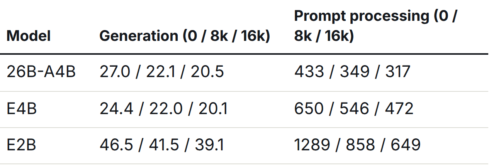
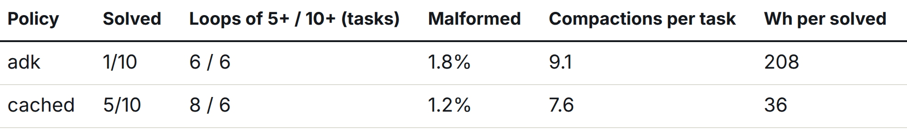
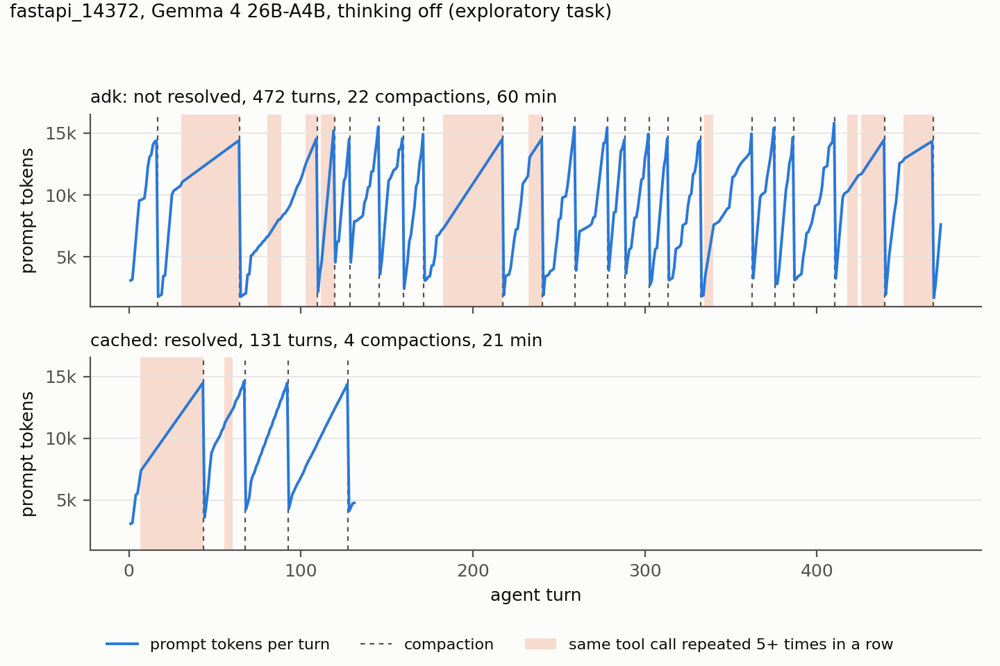
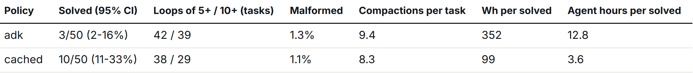
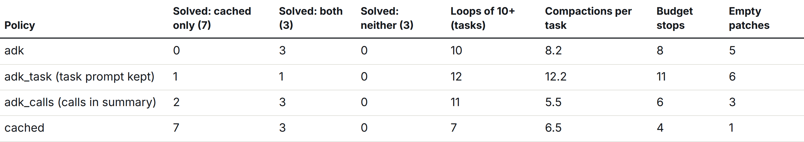
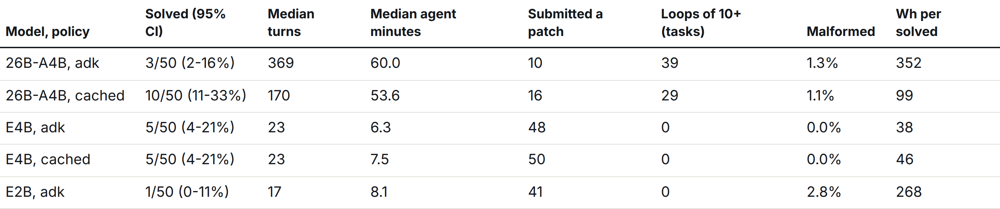

## Abstract

Can a laptop chip with no discrete GPU run the agent setup of the Gemma 4 Developer Agent competition? We ran Gemma 4 26B-A4B, E4B and E2B (Google's QAT Q4_0 builds) on a Ryzen AI 9 HX 370. The model runs on the chip's integrated Radeon 890M through llama.cpp's Vulkan backend.

The tasks came from the 129 published competition tasks. We scored them with a local copy of the grader: its reference fixes pass on 127 of the 129, and an empty patch passes on 2.

The mixture-of-experts 26B-A4B generates text at least as fast as the dense E4B (27 against 24 tokens/s) and, with a context policy that keeps observations, solves twice as many tasks (10 against 5 of 50). Speed was therefore not the limit; the agent loop was. With the official sampling settings (a thinking budget of 4,096 tokens) a turn takes about five minutes, so a 60-minute budget allows about 15 turns. With thinking off, the summary step that the reference harness runs when context fills up keeps only the model's prose. 26B-A4B writes almost none next to its tool calls, so the agent loses the task and starts repeating itself.

Our alternative writes a progress note inside the cached conversation and keeps the task prompt. On 10 exploratory tasks it raised the number solved from 1 to 5. On the 50 tasks we fixed in advance for the confirmatory test, it solved 10 against 3 (exact McNemar p = 0.016), at 99 Wh per solved task. We release the grader copy, the agent runner and all agent traces.

## 1. Introduction

The competition asks small Gemma 4 models to fix real bugs inside a fixed agent harness running on four L4 GPUs. A developer at home has neither the GPUs nor the harness. We wanted to know what one consumer machine gets out of the same models and tasks, and where a local agent actually loses.

We studied three things, and two are negative results. How fast a model runs on unified memory has a clear answer, and it favours the mixture-of-experts model (Section 4). We expected long contexts and prompt processing to dominate the time; thinking tokens did (Section 5). Context management decides most of what a small agent can solve in a fixed time budget (Section 6), and that result comes from a pre-registered comparison: we fixed the 50 test tasks and the statistical test before any of those runs existed.

## 2. Setup

### 2.1 Hardware and inference

- **Machine:** one mini PC with an AMD Ryzen AI 9 HX 370 (12 cores) and a Radeon 890M integrated GPU (RDNA 3.5).
- **Memory:** 58 GiB of LPDDR5X shared between CPU and GPU. The GPU can map about 30 GiB of it.
- **Inference:** llama.cpp (build 2606220), Vulkan backend, flash attention, two parallel request slots of 32,768 tokens each (the reference harness's context), and prompt (prefix) caching on, so tokens already processed in earlier requests are not recomputed.
- **Models:** Google's official QAT Q4_0 GGUF files for Gemma 4 E2B (3.1 GiB), E4B (4.8 GiB) and 26B-A4B (13.4 GiB), with checksums verified.
- **Power:** package power (CPU and GPU together) read from the amdgpu sensor once per second. A run's energy is the power integrated over its time window, shared equally among the runs active at each moment. Package power at idle is 48 W.

### 2.2 Grader fidelity

A local score means little if the grader disagrees with the official one, so we measured our copy before running any agent on it. Our first copy passed the reference patch on only 58 of 129 tasks. Of the 71 failures, 48 were our own installer ignoring version limits (fastapi snapshots pinned to Starlette below 0.49 got Starlette 1.6), 5 were requests dependencies we never read from `setup.py`, 7 were test-only packages missing from the published offline wheel set, 8 were newer library versions changing exact expected output and 3 were async tests that the grader's `-p no:anyio` flag disables. None were timeouts or flaky tests.

The fixed copy (v3) builds one base image per repository holding the newest published wheels and pytest 8.4.2, then installs the versions each snapshot's own `pyproject.toml` allows. It adds 19 test-only wheels from PyPI and applies the per-task pins and the asyncio shim that Kirchner published for the same tasks [1].

Reference patches now pass on 127 of 129 tasks, and the empty patch passes on 2. The two remaining failures need Python 3.12; the two empty passes have tests that cannot tell fixed code from unfixed. The 125 usable tasks, where the reference patch passes and the empty patch fails, are fastapi 65, rich 47, requests 12 and httpx 1.

### 2.3 Agent loop

Our runner reproduces the reference harness's agent contract: the same task prompt sections and the same nine tools with the same output limits, the three continuation nudges, a 60-minute agent budget with 500 turns and 300 s per command, a 4 GiB / 2 vCPU sandbox with no network, the sample submission's system prompt, and temperature 0.2 with top_p 0.95.

We differ from the reference harness in three ways. There is no analyser sub-agent. Tool calls that fail to parse are counted as malformed and answered with the unclosed-call nudge. Thinking is off, except in the Section 5 arm and the post-hoc arm in Section 8.

### 2.4 Tasks and pre-registration

Before any agent ran we drew a stratified random sample of 60 of the 125 usable tasks (seed 20261101). The first 10 are the exploratory set (E): we used them for the feasibility check, and they informed the design of the cached policy. The other 50 are the confirmatory set (C). Before any C run existed we froze the analysis plan: paired exact McNemar test, cached against adk policy, 26B-A4B, thinking off, alpha 0.05 (sha256 recorded in the repository).

## 3. What we measure

For each run we record the grader result, stop reason, turns, malformed responses, per-request token counts and times, tool time, compactions and energy. The loop rate is the number of tasks with at least N identical consecutive tool calls, for N = 5 and N = 10.

## 4. Speed: the mixture of experts wins on unified memory

**Table 1. Single-stream llama-bench speed, tokens per second, at three context depths.**

On this chip, generation speed is limited by memory bandwidth: it is roughly the bandwidth divided by the bytes read per token. 26B-A4B activates about 4B of its 25B parameters per token, so it generates as fast as the dense E4B, and slightly faster at short context. Prompt processing is limited by compute, and there the larger model pays: it is 1.5 times slower than E4B. With two requests running at once, each gets about 14.5 tokens/s, about 29 in total.

On speed alone, the mixture-of-experts model is the right choice for a laptop.

## 5. The cost of thinking

The sample submission enables thinking with a 4,096-token budget. We ran that configuration first, on the first two exploratory tasks. Every turn spent the whole thinking budget, about 4,100 generated tokens or 4.8 minutes at 14.5 tokens/s, and one turn produced 16,384 tokens and no tool call. Both tasks hit the 60-minute budget unsolved, after 15 and 65 turns, and we stopped the arm there. Generation took 74% of agent time, prompt processing only 3% (96% of prompt tokens came from the cache) and tools 0.2%.

We had expected the opposite. Our plan assumed that long contexts and re-processed prompts would dominate on a chip that processes only about 350 prompt tokens/s. Prefix caching removes that cost almost entirely. What remains is generating tokens, and thinking multiplies the tokens per turn.

With thinking off, a turn takes about 10 to 20 seconds, and the agent gets hundreds of turns within the budget. All later arms run with thinking off, except one post-hoc arm (Section 8); we disclose this as a deviation from the reference configuration.

## 6. Context policy decides capability

### 6.1 Two policies

The reference harness bounds context with Google ADK's event compaction. When the prompt passes a token threshold (we use 14,336, measured with swegemma 0.2.11 [2]), it summarises older events with a separate model call and keeps the last five events.

We read the summariser in google-adk 1.36.1, the version reported for the harness [2], [7]. `LlmEventSummarizer._format_events_for_prompt` keeps only parts whose `text` is non-empty, so every tool call and every tool result is left out of the summary input. Thoughts stay in, because ADK's LiteLLM adapter stores reasoning as text parts marked `thought=True` and the summariser does not filter them. 26B-A4B wrote almost no prose next to its tool calls in our runs: 8 of 882 tool-call turns with thinking on, 2 of 36,102 with thinking off.

So in the reference configuration (thinking on), the summary sees the task prompt and the model's thoughts but no observation. With thinking off it sees the task prompt and the nudges, nothing more. Either way the agent's record of what it ran and saw does not survive compaction. The task prompt survives only as rewritten by the summary, because it is itself an older event.

Our **adk** policy reproduces this. The summary prompt is ADK's own, sampled at the defaults the harness falls back to [2]. One difference: we insert the summary as a user message, where ADK marks it as model content.

Our **cached** policy changes three things:

1. It asks for the progress note as one more user turn in the existing conversation, so the request reuses the cache and only the note has to be generated.
2. The request asks for files, findings, edits and test outcomes, so observations make it into the note.
3. It keeps the system prompt, the task prompt verbatim, the note and the last five events.

Both policies use the same threshold, the same retention and the same nudges.

**Related approaches.** SWE-agent collapses every observation older than the last five into one line; its ablation found this better than keeping the full history (18.0% against 15.0% on SWE-bench Lite) [4]. Lindenbauer et al. report that simply masking old observations matches LLM summarisation in solve rate, at about half the cost, on SWE-bench Verified [5]. Our setting differs from both: the model is small and runs locally, the summariser is the stock one in a fixed harness, and the failure we measure is losing observations altogether, not paying to keep them.

### 6.2 Exploratory tasks (E, n = 10)

**Table 2. Exploratory tasks, 26B-A4B, thinking off.**

Four tasks were solved only under cached, none only under adk. Figure 1 shows one of those four: the adk run compacts 22 times and keeps falling back into runs of identical calls, while the cached run breaks out of an early loop at its first compaction and solves the task in 131 turns.

**Figure 1. Prompt size per turn for one exploratory task (fastapi_14372) under each policy.** Dashed lines mark compactions; shaded spans mark five or more identical consecutive tool calls. The plotted data is in `fig_timeline_fastapi_14372.csv`.

The adk runs repeat themselves after compaction. In one task (rich_3934), 426 of 499 tool calls were the same command, 106 of them in a row. Cached does not remove loops: 6 of 10 tasks still had runs of 10 or more. But the agent keeps the task statement and recent results, and it solved five tasks.

### 6.3 Confirmatory tasks (C, n = 50)

**Table 3. Confirmatory tasks, 26B-A4B, thinking off.**

The pre-registered test passes. 7 tasks were solved only under cached and none only under adk; 3 were solved under both. Exact McNemar p = 0.016, below the alpha of 0.05 fixed before the runs.

Each fix costs about a third as much. A task costs about the same energy under either policy (19.8 against 21.1 Wh), so tripling the number solved cuts the cost per solved task from 352 to 99 Wh and from 12.8 to 3.6 hours of agent time.

Loops remain common under both policies. 29 of 50 cached runs still contain a run of 10 or more identical calls (39 under adk), and most unsolved runs stop at the 60-minute budget (27 cached, 36 adk). The policy keeps the task in view; it does not stop repetition.

The rate is lower than on E (20% against 50%). E shaped the design, so C is the estimate to quote. The per-task results are in `results/laptop/main_26b/results.jsonl`, and `code/analysis/confirmatory.py` reproduces every number in this section.

### 6.4 What adk loses (post-hoc ablation)

**Table 4. Post-hoc ablation, 13 C tasks, 26B-A4B, thinking off, one run per cell.** adk and cached are the section 6.3 runs, which define the task groups.

Which change matters? After the confirmatory runs we gave adk one of cached's changes at a time and ran each variant once on 13 C tasks: the 7 solved only under cached, plus 3 solved under both and 3 under neither, drawn at random (seed 20261102). **adk_task** keeps the task prompt verbatim; **adk_calls** also passes tool calls and results to ADK's summariser.

Neither alone recovers cached. adk_calls solved 2 of the 7, kept all 3 shared solves and compacted least. adk_task solved 1 of the 7, lost 2 of the 3 shared solves and hit the budget on 11 of 13 tasks. The cached row was selected on its own successes, so 7 of 7 overstates it, and with one run per cell and about 15% run-to-run flips [3] these are counts, not effects. Observations matter more than the verbatim task; we did not test both together.

## 7. Which model

**Table 5. The three models on the 50 confirmatory tasks, thinking off.**

The pre-registered model comparison ran E4B and E2B under adk on the same tasks. The smaller models do not just solve fewer tasks; they work differently. E4B submits a patch after a median of 23 turns and 6 minutes, compacts about once per task and never repeats a call ten times in a row. Under the same adk policy it solved 5 tasks against 3 for 26B-A4B (3 solved only by E4B, 1 only by 26B-A4B; exact McNemar p = 0.63), at 38 Wh per solved task, the lowest of any arm. E2B solved 1 and submitted an empty patch on 28 of 50 tasks.

The cached policy does not help E4B. With it, E4B again solved 5 of 50 (2 tasks only with cached, 2 only with adk), submitted a patch on all 50 tasks and compacted 1.4 times per task, against 8.3 for 26B-A4B. A model that stops this early never reaches the point where the context policy decides what it keeps.

So the larger model's capacity pays off only when the context policy keeps the task and its observations.

The two models also solve different tasks. E4B solved two requests tasks that 26B-A4B with cached did not. Running E4B first, and 26B-A4B with cached only on its failures, would have solved 12 of 50 in 38 agent hours, against 10 in 36 for 26B-A4B alone (post hoc, one run per task).

## 8. Limitations

- **One machine and one seed.** Run-to-run variation in this competition is large: about 15% of tasks flip between identical runs on the official hardware [3]. Our paired design controls the task mix, but not sampling noise.
- **A copy of the grader, not the official scorer.** We report its fidelity, but hidden-task behaviour may differ.
- **Quantisation.** Q4_0 models on a different inference engine (llama.cpp rather than vLLM) cannot be compared one-for-one with leaderboard numbers.
- **Thinking is barely tested.** The 4,096-token cost figures come from two tasks. A post-hoc 1,024-token arm on 20 confirmatory tasks (cached, seed 1 only) solved 6 against 3 with thinking off (discordant 4-1, exact McNemar p = 0.375), suggestive but not significant. One solve (rich_2725) ended on a parse error; its working-tree patch passed (5 against 3 without it).
- **Missing parts of the reference loop.** We omit the analyser sub-agent and the interval-based compaction trigger.
- **The compaction threshold may not match the scorer.** The 14,336-token threshold comes from a participant's local runs of swegemma 0.2.11 [2]; the published harness guide gives 32,768. The hosts had not confirmed the scorer's current setting when asked on 23 October [6].
- **One adk deviation in the 4,096 arm.** Our adk policy leaves thoughts out of the summary input, where ADK keeps them. It affects only the two-task 4,096 arm (0.5 compactions per task).

## 9. Release

Everything is released under Apache-2.0: the grader copy (base image recipe, installer, calibration list and fidelity results), the agent runner with every policy, the power logger and the analysis scripts, the frozen pre-registration (sha256 32717a8e…) and all traces except one discarded after an HTTP 500. The code is on GitHub at `CVasilopoulos/gemma4-laptop-agent`; the traces and results are in the Kaggle dataset `chrisvas123/gemma4-laptop-agent-traces`, linked from this Writeup.

The traces carry upstream code from fastapi, rich, requests and httpx under their own licences. Problem statements (model-quoted fragments are redacted), reference patches, test patches and the competition's sample prompt are not included (the prompt appears only as its hash).

## Acknowledgements

AI-assisted, human-directed.

## References

[1] Z. Kirchner, "Gemma 4 Agent: Do Gold Patches Pass Locally?", Kaggle notebook, Oct 2026.
[2] A. Chen, "Compaction summary call ignores the submission's temperature, top_p and top_k", competition forum topic 753225, Oct 2026.
[3] R. Zhu, competition forum topic 747168, Oct 2026.
[4] J. Yang et al., "SWE-agent: Agent-Computer Interfaces Enable Automated Software Engineering", arXiv:2405.15793, 2024.
[5] T. Lindenbauer et al., "The Complexity Trap: Simple Observation Masking Is as Efficient as LLM Summarization for Agent Context Management", arXiv:2508.21433, 2025.
[6] A. Arun, "Current scorer contract: charged time limit, compaction settings, and repository split", competition forum topic 752017, Oct 2026.
[7] Google ADK (adk-python) v1.36.1, `src/google/adk/apps/llm_event_summarizer.py` and `src/google/adk/models/lite_llm.py`.
